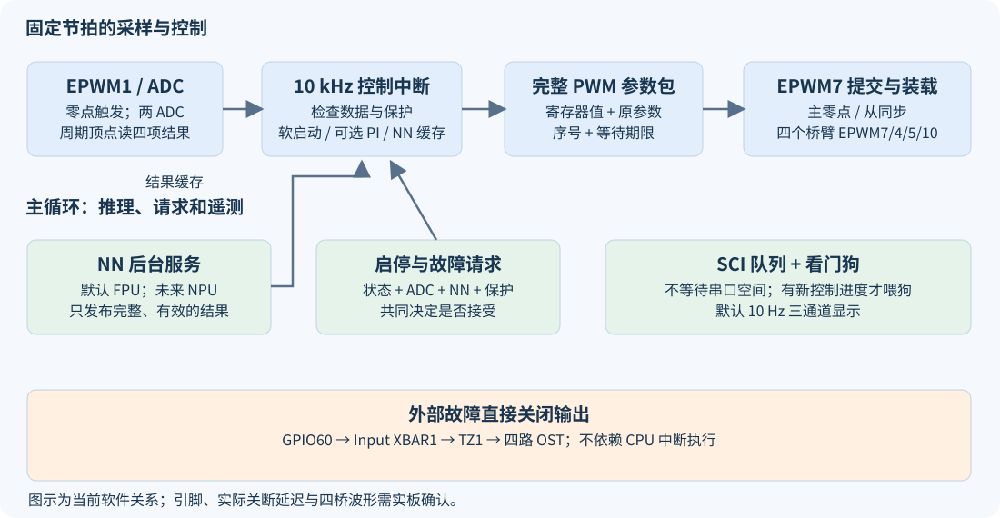
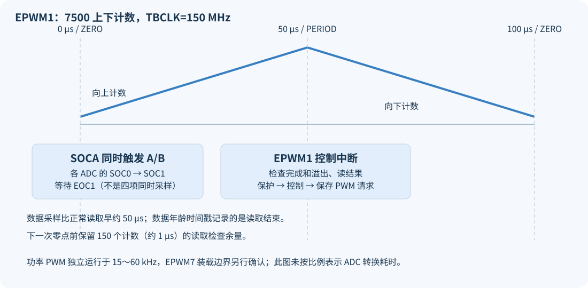
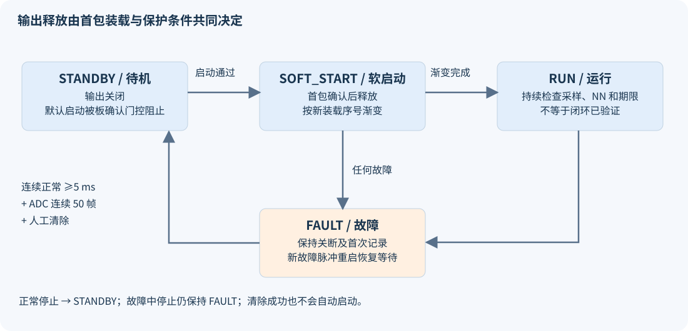

# F28P550 DAB 控制项目上手与配置说明

版本：2026-10-08，已按 LAUNCHXL-F28P55X 更新。适用项目：`dab_control_f28p550`，对应本次软件修正后的代码。

2026-10-08 补充关键功能的中文行尾和代码段注释，涵盖 17 个源码/头文件；控制逻辑、配置参数和模型权重保持一致。编辑器及电脑测试明确使用 UTF-8，避免中文乱码；[注释前后代码一致性记录](../../review_20261003/chinese_annotations_20261008/comments_only_verification.json)与[本次重新构建及测试结果](../../review_20261003/checks_annotations_20261008/verification.json)单独保存；该记录对应补注释当时版本。随后按已确认的 LaunchPad 型号修正了工程配置和故障 LED 极性，随后将 PWM 集中到 J8、ADC 集中到 J7，辅助信号在 J6；当前结果见第 14 节。

**当前可运行的软件基准是 FPU 神经网络版本，真实 DAB NPU 模型尚未接入。** 默认禁止功率输出、禁止自动启动、使用 NN 开环模式；编译和电脑上的逻辑验证已完成，开发板上的波形、保护动作、传感器精度和闭环稳定性尚未验证。

本文把“代码现在做什么”“为什么这样配置”“改动应该在哪里”“还需要什么实验”放在一起。新手建议按第 1、3、4、6、7、8、11 节阅读，再使用第 12 节操作 CCS；准备接入功率板时逐项填写第 15 节的验收表。

## 1. 五个项目分别用于什么

| 目录 | 角色 | 应重点学习的内容 | 与当前 DAB 的关系 |
|---|---|---|---|
| `ex_led_ch1` | F28P550 入门例程 | 时钟、GPIO、LED、工程构建 | 验证基础环境；不是功率控制代码 |
| `ex_dma_adc_2.3.1_ch2` | F28P550 ADC/DMA 参考例程 | ADC 触发、转换结果、DMA 搬运 | 参考配置方法，不能直接套用其通道与采样时刻 |
| `ml_arc_detection_F28P55x_ch7` | F28P55x NPU 电弧识别参考例程 | TI NPU 初始化、模型接口、完成通知、存储安排 | 参考运行接口；电弧模型的输入、输出和模型库不能当作 DAB 模型 |
| `DAB_20250829_Ver4` | F28335 原始 DAB 程序 | 原控制含义、手写 NN 权重、相移算法、旧采样系数 | 功能迁移的数值基准；其寄存器配置不能用于新芯片 |
| `dab_control_f28p550` | 当前目标程序 | ADC、四路 ePWM、控制状态、NN、保护、SCI | 本文说明和本次修改的对象 |

原程序最后把 PI 修正量 `F_duty` 覆盖成零，因此新程序默认保留 NN 开环行为。新程序提供可选择的闭环分支，但保留该分支不等于已完成闭环调试。

## 2. 认识芯片和常用名称

F28P550 属于 TI C2000 实时控制 MCU。本项目将 C28x CPU 配置为 150 MHz，使用 FPU 进行浮点计算；芯片的 CLA 是可承担控制计算的协处理器，NPU 是用于神经网络运算的硬件，两者目前均没有承担本项目的实际控制计算。

| 名称 | 初学者可以如何理解 | 本项目的使用情况 |
|---|---|---|
| ADC | 把引脚电压变成数字 | ADCA/ADCB 读取四个量；不是“双 CPU” |
| SOC / EOC | 一次采样转换的启动 / 转换结束 | 每个 ADC 使用 SOC0、SOC1，EOC1 表示这两次转换结束 |
| ePWM | 按定时计数生成开关信号 | EPWM7/4/5/10 控制四桥臂，EPWM1 提供采样和控制节拍 |
| TBPRD / TBCTR / TBPHS | 计数上限 / 当前计数 / 同步时载入的相位值 | 决定频率、更新时机和桥间相移 |
| Shadow / Global Load | 先保存新参数，等指定事件再生效 | 减少四个桥臂出现不同版本参数的风险 |
| Trip Zone / OST | 外设直接关闭输出 / 关闭状态锁存 | 外部故障和软件故障都保持 PWM 为低 |
| CMPSS / PPB | 连续模拟比较器 / ADC 结果附加处理 | 尚未配置；是下一阶段保护改进方向 |
| SCI | MCU 串行通信外设 | SCIA 向 VOFA+ 发送三通道数据 |
| PIE / ISR | 中断分配机构 / 事件发生时执行的函数 | EPWM7 和 EPWM1 都在 PIE group 3，当前不嵌套 |
| Driverlib | TI 封装外设寄存器操作的库 | 应用使用这些 API，而不是直接照搬 F28335 寄存器 |
| CPUTimer2 | 连续运行的硬件计数器 | 统一用于数据年龄、超时、遥测和故障时间记录 |

这里的 C28x `char` 是 **16 位**，`sizeof(float)` 为两个可寻址字，而线路上的一个字节仍是 8 位。通信不能把 PC 上的“逐 char 复制 float”代码直接搬过来；当前明确拆出四个 8 位数据发送。[TI C28x 字节访问说明](https://software-dl.ti.com/ccs/esd/documents/c2000_byte-accesses-with-the-c28x-cpu.html)

**开发板已确认为 TI LAUNCHXL-F28P55X，MCU 完整型号为 TMS320F28P550SJ9PZ，100 引脚 PZ 封装。** 四个 CCS 构建配置已统一为 SJ9 和 `_LAUNCHXL_F28P55X`，默认连接为板载 XDS110；`device.h` 也固定使用 LaunchPad 配置，避免旧生成文件漏掉宏时选错 LED 引脚。SJ9 的资源可按 [TI 数据手册](https://www.ti.com/lit/gpn/TMS320F28P550SJ)查询；当前 FPU 程序无需扩大已验证的内存安排，真实 NPU 模型接入时再按模型要求分配。板卡身份不能确定外接 DAB 功率板的接线、标定和芯片实际 revision。

## 3. 从数据到开关信号：总览



一条控制链包含：外设触发采样 → 读取完整结果并换算 → 检查保护 → 读取已完成的 NN 结果 → 按软启动和可选 PI 计算参数 → 保存完整 PWM 参数 → EPWM7 中断写入 → 零点和同步事件使参数生效。

主循环负责启停请求、NN 推理、串口发送和看门狗服务。控制中断不等待 NPU 完成，也不等待串口发送完毕；两类任务通过完整结果和状态交换信息。

| 执行位置 | 函数 | 主要工作 | 默认节拍 |
|---|---|---|---|
| 初始化 | `main`、各模块 `_init` | 时钟、保护、ADC、NN、控制、PWM、SCI | 复位后一次 |
| EPWM1 中断 | `dab_control_ISR` | ADC 读取、NN 超时检查、保护和控制计算 | 10 kHz，即 100 μs 一次 |
| EPWM7 中断 | `dab_pwm_commit_ISR` | 硬件故障检查、参数提交、装载进度记录、首次释放 | 通常 15～60 kHz，启动释放时临时切到零点 |
| 主循环 | `DAB_NN_service` | FPU 或未来的 NPU 推理，发布缓存结果 | 输入变化达到 0.1 V 时 |
| 主循环 | `DAB_Telemetry_service` | 每次最多放入 16 个线路字节 | 每次循环尝试，FIFO 满则立即返回 |
| 主循环 | `serviceWatchdog` | 有新控制中断进度才喂狗 | 每次循环检查 |
| 主循环 | `DAB_Telemetry_sendVOFA` | 三个 float 编成整帧放入队列 | 10 Hz，即 100 ms 一次 |

EPWM1 固定 10 kHz，功率 PWM 可变为 15～60 kHz，因此两个计数器的相位关系会变化。当前采样未固定在功率 PWM 的安静位置，这一项仍需要板上观察开关噪声后改进。

## 4. 代码在哪里：推荐阅读路线

文件均位于 `dab_control_f28p550`，表中的相对位置用于说明目录关系。

| 文件 | 阅读时要回答的问题 | 关键入口 |
|---|---|---|
| `dab_main.c` | 程序如何开始，哪些工作在后台？ | `main`、看门狗服务 |
| `dab_types.h` | 各状态、数据和基本常量是什么？ | `Dab_State_e`、`Dab_Sensing_t`、`Dab_PwmParams_t` |
| `dab_board_config.h` | 哪些引脚和配置必须按自己的板修改？ | 板确认开关、通道、系数、模式、软件期限 |
| `device/device.h`、`device/device.c` | 时钟、开发板 LED/SCI、Flash 运行代码如何配置？ | `Device_init`、`DEVICE_SETCLOCK_CFG` |
| `dab_adc.c/.h` | 从何处采样，什么时候读，如何拒绝旧数据？ | `DAB_ADC_init/read/isReady` |
| `dab_control.c/.h` | 什么时候允许启动，如何算 PI 和软启动？ | `DAB_Control_start/step/stop/faultReason` |
| `dab_pwm.c/.h` | 四桥如何同步更新，何时真正允许输出？ | `DAB_PWM_init/updateModulation`、两个 ISR |
| `dab_protect.c/.h` | 哪些故障真的会关闭输出，如何恢复？ | `DAB_Protect_checkFault/clearFault` |
| `dab_nn.c/.h` | 输入与输出含义，推理在哪里，NPU 如何切换？ | `DAB_NN_service/getOutput/checkDeadline` |
| `dab_math.h` | 数字异常、输出边界和 PI 如何处理？ | `DAB_isFinite`、`DAB_nnOutputValid`、`DAB_piStep` |
| `dab_telemetry.c/.h` | 三个通道是什么，串口忙时怎么办？ | 编码、有限队列、FIFO 服务 |
| `28p55x_generic_*_lnk.cmd` | 程序、变量和 NPU 工作区放在哪里？ | `.TI.ramfunc`、`.rodata.tvm`、`.bss.noinit.tvm` |
| `.cproject`、`.ccsproject`、`targetConfigs/` | 构建参数和调试连接是否匹配？ | 构建配置、实际器件、调试器 |
| `model/` | 目前有哪些模型产物？ | FLOAT ONNX、清单、验证向量 |

`CPU1_RAM/syscfg/` 是生成目录，`Board_init()` 在当前 `main` 中**没有调用**；应用自己配置引脚。只在 SysConfig 界面修改 GPIO 并不会自动改变当前运行配置，手工修改生成的 `board.c` 也容易在下一次生成时丢失。

## 5. 当前默认配置速查

这些数值来自当前代码和时钟计算，均不是实板测量结果。

| 项目 | 当前配置 | 含义与修改位置 |
|---|---|---|
| 时钟来源 | LaunchPad 板载 20 MHz XTAL，经 PLL 得到 150 MHz | `device/device.h`；板上测试仍需测实际时钟 |
| LSPCLK | SYSCLK / 4 = 37.5 MHz | SCI 时钟 |
| ePWM TBCLK | 150 MHz，无额外分频 | 一个计数约 6.667 ns |
| 功率 PWM 基准 | `DAB_BASE_TBPRD=2500` | 上下计数，30 kHz |
| 功率 PWM 范围 | TBPRD 1250～5000 | 60～15 kHz，由 NN 的 T 和软启动决定 |
| 控制节拍 | `DAB_CTRL_TBPRD=7500` | 10 kHz，`DAB_CTRL_FREQ_HZ` 是对应说明常量 |
| 死区 | RED/FED 各 50 个计数 | 约 333 ns；未按本板驱动器测量调整 |
| ADC 时钟 | SYSCLK / 2 = 75 MHz | 当前使用整数分频 |
| ADC 参考 | 内部 3.3 V，12 位转换 | 内部参考初始化等待 5 ms |
| 采样窗口 | `ADC_setupSOC(...,15U)` | 15 个 SYSCLK，约 100 ns；不是 15 个 ADCCLK |
| 平均长度 | 电压 50 点，电感电流 10 点 | `dab_adc.c`；IOUT 只计算瞬时值 |
| 板确认 | `DAB_BOARD_CONFIG_CONFIRMED=0` | 默认启动拒绝码 1，保持关闭输出 |
| 自动启动 | `DAB_AUTO_START=0` | 使用明确的人工启动请求 |
| 控制模式 | `DAB_CONTROL_MODE=0` | NN 开环；设为 1 才使用 PI 修正 |
| NPU | 未定义 `DAB_USE_HARDWARE_NPU` | FPU 模型可直接编译，硬件 NPU 依赖尚缺 |
| Vin | 固定 `DAB_NOMINAL_VIN=90.0f` | 不代表已经测量实际输入电压 |
| PI | kp=0.00005、ki=0.0001、ref=40 | `DAB_Control_init`；开环下修正量为零 |
| 看门狗 | `DAB_ENABLE_WATCHDOG=1` | 名义约 0.839 s 未喂狗则复位 |
| 遥测 | SCIA、115200、8N1，10 Hz | 分频取最近整数后实际约 114329 baud |

| 软件检查 | 当前界限 | 作用与限制 |
|---|---|---|
| ADC 读边界 | 下降计数且 TBCTR≥150 | 距下一次采样约 1 μs；不是读函数耗时上限 |
| PWM 写边界 | 开始要求下降计数且 TBCTR>1050；中途要求 TBCTR>600 | 开始时额外预留约 3 μs 写入预算，保留原 4 μs 边界；仍需测最坏耗时 |
| ADC 新鲜度 | 最近有效读取不超过 150 μs | 时间戳是读取结束，采样本身通常更早约 50 μs |
| PWM 更新期限 | 等待提交或装载不超过 300 μs | 不能通过覆盖新请求延长旧请求等待 |
| NPU 运算期限 | 1000 μs | 晚到的完成通知同样判超时；不自动复用缓冲区 |
| 故障恢复条件 | 持续正常至少 5000 μs | 同时要求连续 50 帧有效采样，且人工清除 |
| SCI 帧服务期限 | 20000 μs | 超时清发送 FIFO 并丢弃软件队列，控制不等待 |

这些软件期限用于发现停滞，不能作为已验证的过流关断时间。特别是发生全局中断停滞时，150/300 μs 检查也无法执行，外部 Trip Zone 和独立看门狗承担不同的故障处理职责。

### 5.1 LAUNCHXL-F28P55X 已确认的板级配置

依据 [TI 开发板用户手册 SPRUJC0A](https://www.ti.com/lit/ug/sprujc0/sprujc0.pdf)和 [TI 官方原理图 SPRR499A](https://www.ti.com/lit/pdf/sprr499)，板卡身份、封装、板载时钟和接口已可确定。排针编号下表沿用 TI 原理图的 BoosterPack **总编号**；本地针号指各个十针排针自身的第几针，不要与 MCU 封装脚号混淆。

| 当前代码用途 | MCU 信号 | 排针总编号 | 排针本地针号 | MCU 100PZ 脚号 |
|---|---|---|---|---|
| 第一桥臂 A / B | EPWM7A/B，GPIO12 / GPIO13 | J8 / 80、79 | 10、9 | 51、50 |
| 第二桥臂 A / B | EPWM4A/B，GPIO6 / GPIO7 | J8 / 78、77 | 8、7 | 97、84 |
| 第三桥臂 A / B | EPWM5A/B，GPIO37 / GPIO35 | J8 / 76、75 | 6、5 | 61、63 |
| 第四桥臂 A / B | EPWM10A/B，GPIO62 / GPIO63 | J8 / 74、73 | 4、3 | 46、47 |
| IO 输出电流采样 | ADCB B0 | J7 / 63 | 3 | 41 |
| IL 电感电流采样 | ADCB B1 | J7 / 64 | 4 | 40 |
| VN 电压采样 | ADCA A5 | J7 / 65 | 5 | 35 |
| VP 电压采样 | ADCA A4 | J7 / 66 | 6 | 36 |
| 外部故障输入 | GPIO60 → INPUTXBAR1 / TZ1，低有效 | J6 / 55 | 5 | 44 |
| 测时输出 | GPIO61 | J6 / 54 | 4 | 91 |
| 数字信号地 | GND | J6 / 60 | 10 | — |
| 模拟信号地 | GND | J7 / 62 | 2 | — |
| 心跳 / 故障指示 | LED4 GPIO20 / LED5 GPIO21 | 板载 LED | 低电平点亮 | 48、49 |
| USB 遥测 | SCIA GPIO28 RX / GPIO29 TX | XDS110 虚拟串口 | S2 左右0/0、J101 UART跳帽连通 | 1、100 |

**当前分配：八路 PWM 集中在 J8 本地第3～10针，四路 ADC 集中在 J7 第3～6针，两个辅助数字信号在 J6 第4～5针。** 全部位于 BoosterPack Site2；数字线束与模拟线束分组连接，外接功率板重新接线必须以这张表为准。J7 第1针是 5 V 电源，不是 ADC 输入。

GPIO4/5 不再输出 PWM，因此 **S4 不再是本程序 PWM 的前置条件**。初始化停用旧 EPWM2/3/6，将未再使用的旧输出脚设为无内部上拉的输入，并复位本次使用的五个 ePWM 后重新配置，避免 RAM 重载保留旧触发或装载设置；GPIO6/7 现在是第二桥臂，不能按旧第四桥臂线序连接。现有程序没有 CAN 控制功能，若以后加入 CAN，应另行配置 GPIO4/5 和 S4。

四桥臂移相算法含义保持不变，实际外设映射改成 **EPWM7/4/5/10**；EPWM7 为主计数器和共同同步源，其他三个直接同步并连接其 GLDCTL2。独立的 10 kHz 采样与控制改用 **EPWM1**，零点 SOCA 触发 ADCA/ADCB、周期顶点的 INT_EPWM1 执行控制；INT_EPWM7 提交功率参数。这些配置必须一并修改，不能只改 GPIO，也不能按连续编号遍历。

两个中断仍不嵌套，且都属于 PIE Group3；同时待处理时，编号1的控制中断优先于编号7的 PWM 提交中断。这与旧版优先顺序不同，B09 必须重新测入口等待和最坏提交时间；固定10 kHz、50 μs采样等待、30 kHz基准功率PWM及死区数值保持不变，不代表实际最坏延迟已经上板验收。

100PZ 封装的 A4/B8 为 MCU 第36脚，A5 为独立的第35脚；A5 与第21脚的 PGA2_INM 不共脚，不能套用其他封装的 A5/PGA 图。新 A4/A5/B0/B1 都不经 S6、不连接 PGA 输出，也不占用 A0/DACA_OUT 或 A1/CMP1_DACL。输入串联电阻默认为 0 Ω，可选 RC 电容未装，100 ns 采样窗仍需按外接前端阻抗验收。

初始化显式将 GPIO12/13、LED20/21 及 SCIA RX 的 GPIO28 设为数字模式，将 A4/A5 对应的 AIO225/249 和 B0/B1 对应的 GPIO253/230 设为模拟模式；仅选择复用功能不保证模拟/数字通路已接通。资料中的一处 B0/AGPIO231 标注与100PZ引脚图不一致，本项目依据实际 MCU 第41脚及 Driverlib 使用 GPIO253，详见[本次引脚核查记录](../../review_20261003/LAUNCHXL_pin_assignment_20261008.md)。

GPIO35/37 同时是 TDI/TDO，因此保留默认**两线 cJTAG**，R44/R45 保持未安装，不能改成同时占用这两脚的四线 JTAG。板载 XDS110 的 USB 和虚拟串口不受本次 PWM 分配影响；RevA 的 R111/R112 装配问题位于调试侧，不能误写成 R44/R45 默认已安装或 J8 一定与调试冲突。

S3 左右均置1（GPIO24/GPIO32=1/1）用于 Flash 独立启动；RAM 程序仍依赖调试器加载。S2 的 UART 路由要求左右0/0、J101 对应跳帽连通。板载晶体占用 GPIO18/19，不能再把这两脚作普通扩展输出。

默认 USB 供电时 JP1 的 5 V 和地跳帽连通，JP2 接通 5 V/3.3 V；外接功率板前按实际供电方案核对跳帽与接地。板上有隔离调试器不等于默认 USB 供电方式已将功率系统与电脑隔离；JP4 为1.2 V监测点，不能作外部供电入口。

`DAB_BOARD_CONFIG_CONFIRMED=0` 继续表示外接 DAB 功率板尚未验收。新分配不改变标定系数、控制频率、死区或默认启动条件；没有外接传感器时 ADC 数值可能浮动，不能当作实际电压或电流。


## 6. ADC：从采样到可信数据

### 6.1 通道、触发和读取时刻

| ADC / SOC | 默认通道 | 变量 | 用途 |
|---|---|---|---|
| ADCA / SOC0 | ADCINA4 | `vout_p_raw` | 原边相关电压，当前不进入电压 PI |
| ADCA / SOC1 | ADCINA5 | `vout_n_raw` | 副边输出电压，保护及 PI 使用 |
| ADCB / SOC0 | ADCINB0 | `iout_raw` | 输出电流观测，尚无独立 IOUT 保护逻辑 |
| ADCB / SOC1 | ADCINB1 | `il_raw` | 电感电流，±25 A 软件越限检查 |

以上是逻辑通道，封装焊盘、连接器和实际传感器接线必须查本板原理图。`vout_p`、`vout_n` 延续旧程序命名，不能仅凭字母推断采样点的电气极性。



EPWM1 上下计数：零点 SOCA 同时触发 A/B 两个 ADC；每个 ADC 内部按优先级先 SOC0 再 SOC1，并非四通道同时锁存。到 50 μs 后的周期顶点产生 EPWM1 中断，读取 A/B 的 EOC1 状态和四个结果；ADCINT1 只作为完成状态使用，没有启用对应 ADC 的 PIE 中断。

读取前后均检查完成、溢出和计数边界，清标志时再检查溢出竞争。若任何一步不完整，就拒绝该帧；这样可以发现读取跨过下一次采样边界，但仍不是各通道采样时刻的精确时间戳。[TI ADC 时序说明](https://www.ti.com/document-viewer/lit/html/SPRUJ53D/GUID-D848BB40-2802-4C48-B351-7E6F56917C94)

### 6.2 原始计数如何换算

当前沿用原程序的参考系数：

```text
VP = 0.0615 × rawVP − 0.6465
VN = 0.0303 × rawVN + 0.2903
IL = 0.0168 × rawIL − 37.314
IO = 0.0168 × rawIO − 37.314
Vin = 90.0（固定值，没有 Vin SOC）
```

**这四个系数没有针对 F28P550 采样板重新标定。** 改电流系数在 `dab_board_config.h`，改电压系数在 `dab_types.h`；必须同时检查采样量程、零点、保护门限和模型输入单位。

例如 rawIL≈2221 时，当前代码算出电流接近 0 A；这个例子只是解释数字转换，不说明实板零电流一定等于 2221。`vin_raw` 字段存在但未采样，`vin_ave=90` 也不构成输入电压保护。

### 6.3 为什么改成原始数值求和

电压保存最近 50 个原始 ADC 值，电感电流保存最近 10 个值，用 32 位整数维护总和，然后只对平均结果做比例和偏置换算。电压总和最大 `50×4095=204750`，不会溢出 32 位整数，也避免长期浮点加减累积偏差；瞬时值仍保留，保护不依赖慢平均。

正常帧每 100 μs 一次，50 点平均的延迟约 `(50−1)×100 μs/2=2.45 ms`，−3 dB 频率约 88.6 Hz；10 点平均延迟约 0.45 ms。50 点适合平滑显示，但会限制快电压控制，下一阶段应把“控制用滤波”和“显示用滤波”分开，当前不在缺少功率级响应数据时直接缩短窗口。

### 6.4 有效、就绪和恢复有什么区别

- 一帧有效：本次读取完整且未越过检查边界，`g_adcFrameCount` 增加。
- 采样就绪：最新帧有效、连续 50 帧有效、最近一次读取年龄≤150 μs，`DAB_ADC_isReady()` 才为真。
- 丢帧或超过期限：`g_adcInvalidFrameCount` 增加，平均历史和连续计数重新开始；显示保留最后一次值，但该值不能用于批准启动。

复位后至少要完成约 5 ms 的有效采样才能就绪；中间任何无效帧都会重新计数。恢复要求比“累计已经采过 50 次”严格，防止一次好数据掩盖最近的采样异常。

当前已启用 ADCINT 连续模式及配套清标志处理；若芯片 revision=0，同时给未使用的 C/D/E 转换器上电。这些处理对应 TI 勘误，不是增加三个实际采样通道。[SPRZ572B ADC 条目](https://www.ti.com/lit/pdf/SPRZ572)

### 6.5 后续采样优化怎么判断

100 ns 只说明 MCU 采样保持窗口，是否足够取决于传感器输出、串联电阻、运放、RC 和模拟引脚。用同一稳定输入比较多个窗口长度，观察误差和前一通道对后一通道的影响，再按 [TI ADC 输入电路分析方法](https://www.ti.com/lit/pdf/SPRACT6) 使用本芯片参数计算；不应把旧器件的输入电容直接代入。

先测量采样在开关周期中的位置和噪声，再决定是否把 SOC 移到功率 PWM 的安静位置、改成 EOC 触发控制、使用 PPB 延迟记录或 DMA。当前只读四个值，DMA/CLA 是否值得引入要依据实际时间占用，而不能只依据芯片具备这些功能。

## 7. PWM：四个桥臂、移相和同步生效

### 7.1 默认引脚和计数方式

| 外设 | 输出引脚 | 代码中的角色 |
|---|---|---|
| EPWM7A/B | GPIO12 / GPIO13 | 主计数器及第一桥臂 |
| EPWM4A/B | GPIO6 / GPIO7 | 第二桥臂，内部相移 D1 |
| EPWM5A/B | GPIO37 / GPIO35 | 第三桥臂，相对主桥的 D0 |
| EPWM10A/B | GPIO62 / GPIO63 | 第四桥臂，内部相移 D2，并带 D0 |
| EPWM1 | 不配置功率输出引脚 | 采样和控制节拍 |
| GPIO61 | 普通输出 | 控制中断执行期间拉高，用于测时 |

逻辑第一/第二桥臂对应原边，第三/第四桥臂对应副边；算法含义保持不变，实际外设为 EPWM7/4 和 EPWM5/10；这仍需实际驱动接线确认。每个 A 输出经 Dead Band 形成互补 B 输出；故障时 A/B 都被 Trip Zone 设为低，实际驱动器是否以低电平表示关断也必须确认。

上下计数时 `fsw=150 MHz/(2×TBPRD)`；增大 `T_gain` 会增大周期、降低频率。变周期会同时改变相位对应的时间，不能把 D0 的变化独立当作唯一功率控制量。

### 7.2 D1、D0、D2、T 具体如何进入寄存器

设 P=`tbprd_var`。当前 A 动作是“下降计数达到 CMPA 时置高，上升计数达到 CMPB 时置低”：

| 外设 | CMPA | CMPB | 同步时相位 | 同步后方向 |
|---|---|---|---|---|
| EPWM7 | P | 0 | 主外设不载入相位 | 自由计数 |
| EPWM4 | D1×P | (1−D1)×P | 0 | 向上 |
| EPWM5 | P | 0 | D0×P | 向下 |
| EPWM10 | D2×P | (1−D2)×P | D0×P | 向下 |

**D1/D2 是桥内相移参数，不是通常意义上的单管占空比。** 一对比较值的和约等于 P，因此理想单桥臂 A 的高电平仍约占完整周期的一半；桥内两腿错开的时间决定桥输出的三电平区间，死区和取整会使实际波形略有差异。

名义上 D0×P 对完整 `2P` 周期对应 `180×D0` 度计数偏移。实际原副边电压的领先/滞后、同步传播延迟和第一次脉冲还受到同步后计数方向、驱动极性与延迟影响，必须从波形确认，不能仅用这个换算判断功率方向。

### 7.3 为什么不直接在控制中断写寄存器

控制计算在固定 10 kHz，开关周期却会变化，直接写寄存器容易让四桥在不同时间用上新值。当前保存一整份参数包，包括整数寄存器值、原参数和序号；EPWM7 到周期顶点后，在距离零点足够远的下降计数区域写入。开始写入必须同时保留 `DAB_PWM_STAGE_BUDGET_COUNTS=450` 和原边界 600，共 1050 计数；进入过晚时不写寄存器，保留请求等后续机会，中途仍以 600 为边界复核，300 μs 总等待期限不变。450 是基于一次约 302 计数实测增加余量的初值，全周期范围和最坏负载仍需验证。

TBPRD/CMPA/CMPB 使用 Shadow 和单次 Global Load：主外设零点载入，从外设在主同步事件载入，GLDCTL2 与主外设关联。**TBPHS 没有相同的 Shadow 机制**，所以写相位前临时禁止从外设相位载入，全部写完后恢复，再最后设置单次装载请求；边界检查失败会关闭输出或等待下一次机会，等待仍受 300 μs 总期限限制。

当前两个生产/消费中断都在 PIE group 3，默认不嵌套，这也是完整参数交换的条件。以后若引入嵌套、CLA 或另一个 CPU/任务写入 PWM，必须重新设计所有权和交接，不能继续假定当前条件成立。[TI Global Load 参考例程](https://github.com/TexasInstruments/c2000ware-core-sdk/blob/699b8c6aa190cf7430a36bdcf7f5b1ea2e928063/driverlib/f28p55x/examples/epwm/epwm_ex14_global_load_use_case.c)

### 7.4 如何知道装载进度，如何安全启动

TI 手册说明 GLDCTL2 的 OSHTLD 写 1 才置位，读回总为零，所以不能轮询它判断“已经完成”。当前预留 EPWM7 SOCB 的零点标志作为事件记录，清标志后才发起装载；后续看到零点时更新 `g_pwmAppliedSequence` 和 `g_pwmAppliedParams`。[TI TRM：ePWM、GLDCTL2 寄存器](https://www.ti.com/document-viewer/lit/html/SPRUJ53)

`Applied` 表示软件观察到配置的装载边界，不是回读四个外设的活动寄存器，更不是证明四桥的实际输出完全同步。第一次启动仍保持 OST，准备并等待首个完整参数跨过装载事件，再检查 ADC、NN 和保护，才清软件关断；停止取消软件等待并重新强制 OST。

写零不能取消已经发出的硬件单次装载；停止后旧请求仍可能在输出被关断时载入。因此停止后的 `g_pwmAppliedParams` 应理解为最后一次被软件确认的参数，不是被取消过程中所有内部寄存器的实时镜像。

### 7.5 PWM 仍需要哪些板上证据

必须同时观察四个桥臂或等效桥电压，覆盖启动、停止、频率和相位边界、快速参数变化、故障后恢复。重点确认无短促异常脉冲、无直通、两桥更新属于同一版本，并测量实际死区；软件里的 4 μs 写入检查和默认 333 ns 死区均不能代替这些证据。

## 8. 控制：DAB 原理、模式和状态

### 8.1 DAB 为什么使用相移

DAB 两侧都是全桥，经变压器和等效串联电感连接；两侧桥电压的差决定电感电流变化，可以概念性写成 `diL/dt=(vpri−n×vsec)/L`，其中 n 和 L 必须按具体电路定义。桥间相移决定平均能量传递，桥内相移及频率又影响电流应力、环流和开关条件。

本程序同时调整 D1、D0、D2 和周期，属于多参数调制。缺少变比、电感、训练目标和电路定义时，不能用标准单相移功率公式直接证明这四个 NN 输出正确；[TI TIDA-010054 DAB 资料](https://www.ti.com/tool/TIDA-010054)可用于学习相移和控制调试方法，不能直接复制其 100 kHz 功率级参数。

### 8.2 开环与闭环

| 模式 | 当前计算 | 使用条件 |
|---|---|---|
| `DAB_MODE_NN_OPEN_LOOP=0` | NN 给出目标调制，PI 修正固定为 0 | 默认模式，保留旧程序最终行为 |
| `DAB_MODE_NN_CLOSED_LOOP=1` | 用输出电压误差算 PI，再修正三种相移 | 需要标定电压和验证对象响应、反馈符号及 PI 参数 |

开环下 `ref=40` 仍参与软启动误差显示，但**不会保证输出稳定在 40 V**。RUN 只表示软件达到运行状态，不表示实板电压、功率或效率符合要求。

### 8.3 当前 PI 如何计算

```text
target = clamp(ref,0,60) × ramp
error = clamp(target − vout_n_ave,−40,+40)
integral_candidate = integral + ki × error
out = clamp(kp × error + adjusted_integral,0,0.15)
```

积分具有输出边界限制和恢复方向处理，保存的积分范围为 ±0.15；开环下积分、输出均为零。ki 是**每次调用**的系数，当前每秒 10000 次，改变控制频率时不能保持 ki 不变并期待相同动态。

PI 输出只允许非负，当前没有经过反向功率控制设计。若要双向 DAB，必须重新定义电压/电流反馈、功率方向、相移范围和故障门限，不能只允许 `out` 为负数。

### 8.4 NN 输出如何转成软启动调制

令 ramp=`s_softCnt/1000`，NN 输出为 `[D1n,D0n,D2n,Tn]`，PI 修正为 u：

```text
D1 = (1−ramp) + ramp × clamp(D1n/Tn − u,0.001,0.999)
D2 = (1−ramp) + ramp × clamp(D2n/Tn − u,0.001,0.999)
D0 = ramp × clamp(D0n/Tn + u,0,0.999)
T_gain = 1 + ramp × (Tn−1)
P = truncate(T_gain × 2500)
```

因此启动起点为 D1=D2=1、D0=0、T=1，逐渐过渡到目标；并非“PWM 单管占空比从零增加”。计数只在已允许输出且观察到**新装载序号**时增加，正常节拍下约 100 ms，实际可能稍长；没有实际更新时不会仅靠控制调用次数进入 RUN，持续停滞会触发超时关闭。

运行中的参考值、输入变化尚没有按功率级确定的变化速度限制。适当限制每次相移/周期变化能减少电流突变，但界限需要电感、变比和实验数据，已经列入后续验收。

### 8.5 状态和命令



| 数值 / 状态 | 含义 | 允许的下一步 |
|---|---|---|
| 0 / INIT | 启动前初值 | 初始化进入 STANDBY |
| 1 / STANDBY | 待机，保持输出关断 | 通过全部条件后启动 |
| 2 / SOFT_START | 首包准备、释放和参数渐变 | 完成软启动到 RUN，或停机/故障 |
| 3 / RUN | 正常控制计算 | 人工停止或故障 |
| 4 / FAULT | 锁存故障，输出关断 | 满足恢复条件并人工清除后回 STANDBY |

启动拒绝码 `g_startRejectReason`：0=接受，1=板配置未确认，2=状态不是 STANDBY，3=ADC 未就绪/过旧，4=NN 未就绪或异常，5=保护未允许，6=NN 测试中，7=NPU 候选模型未批准功率控制。请求被读取后即消耗，不会因为以后条件满足而自动执行旧请求。

## 9. NN 与 NPU：现在做到哪里

### 9.1 FLOAT 基准网络

网络为 `3→29→12→6→4`：前三层 ReLU，最后线性输出，582 个权重/偏置。当前 FPU 版本保留原模型参数，循环实现代替旧程序大量手写表达式，相关函数从 RAM 执行。

```text
input[0] = −0.5
input[1] = Vin / 140
input[2] = 0.285714
output = [D1,D0,D2,T]
```

两个常量输入代表什么物理量、训练域是什么，现有代码和文件不足以确认。当前 Vin 固定为 90 V，主循环通常只计算一次并使用缓存；真实测量 Vin 接入后，变化达到 ±0.1 V 才更新，不能据此说 NPU 每 100 μs 运行一次。

### 9.2 输出检查和超时

四个输出必须有限，T 必须在 0.5～2，三种相位值必须在 `−0.005×T` 到 `1.005×T`。保留少量负数容差，是因为旧 FLOAT 基准在对照向量上出现小负 D2；后续映射仍作边界限制，超过容差的异常值直接故障。

这个检查只保证接口数值合理，不证明模型适用于当前电路，也不定义训练安全范围。量化后必须再次验证误差映射到 PWM 计数、实际相移和电流的影响，不能以单个误差数字代替输出边界验证。

NPU 运行采用一组长期存在的输入、输出和描述对象，一次只允许一项运算。主循环检查完成，控制中断也检查 1 ms 超时；超时锁定故障，即使随后完成也不接受，更不会启动下一次运算覆盖仍可能被 NPU 使用的缓冲区。

### 9.3 model 目录各文件是什么

| 文件 | 当前内容 | 能否直接用于硬件 NPU |
|---|---|---|
| `dab_float_baseline.onnx` | FLOAT32、输入 `[1,3]`、输出 `[1,4]`，原权重基准 | 还不能；需要 TI 支持的模型编译过程 |
| `dab_model_manifest.json` | 模型结构、单位、文件摘要和既有对照结果 | 用于追踪版本 |
| `validation_vectors_NOT_calibration.csv` | Vin 20～140，步长 1，共 121 个回归向量 | 不是代表性校准数据，也不是训练范围声明 |
| `generated/npu/tvmgen_default.h` | TI NNC 2.1.1 真实生成，输入 16 项 FLOAT32 | 已接入专用配置；Vin=90 V 已核对，全范围精度仍待验收 |
| `generated/npu/mod.a` | DAB16 模型库，四层矩阵运算使用 NPU | 已编译链接；仅核对/计时，禁止功率启动 |

当前 FPU 与原表达式在电脑上对照的最大绝对误差为 **3.91155481×10⁻⁷**；ONNX 清单记录此前独立 ONNX 对照结果，不应把两种验证误差混为一项。都未证明真实 NPU 的数值或运行速度。

### 9.4 已接入真实 NPU，功率控制仍待精度验收

`CPU1_LAUNCHXL_NPU_FLASH` 已加入真实 DAB 模型库、16 项输入适配、GS1 工作区和最终完成计时。仅 `features[1]=Vin/25-4.6`，其余为零；输出仍为 `[D1,D0,D2,T]`。旧三输入接口的 `DAB_NPU_FLOAT_IO_CONFIRMED` 不适用于这个模型。

TI NNC 对原候选 `MatMul` 图会回退到 CPU，现已等价改写为四层 1×1 Conv；501 点转换前后输出一致，生成代码与最终链接确认四个 NPU 阶段。原 FLOAT 基准与 INT8 候选仍有最大约 0.049 的输出误差，92.2～92.5 V 部分点还不满足已有输出范围检查，因此该配置强制禁止功率启动（拒绝码 7），不能只改板确认宏绕过。

开发板操作、六组期望输出、完成时间含义、重建命令和剩余验收见 [NPU 接入说明](NPU_integration_guide_zh.md)。实际硬件输出和耗时尚待开发板核对；电脑接口替身只验证调用与保护逻辑。

## 10. 保护、恢复和看门狗

### 10.1 哪些保护现在真的有效

| 路径 | 当前行为 | 限制 |
|---|---|---|
| 外部故障 | GPIO60 低 → Input XBAR1 → TZ1 → 四路 OST，A/B 低 | 依赖真实故障源、接线及驱动关断电平 |
| 输出过压 | 瞬时 `vout_n≥80` → 软件故障 | 采样及标定正确才有效，反应受 10 kHz 和读取延迟影响 |
| 电感过流 | 瞬时 `il≥25` 或 `il≤−25` → 软件故障 | 不是连续硬件比较器，可能错过采样间尖峰 |
| 采样、NN、PWM 异常 | 不可信、超期或越界 → 关闭并记录 | 检查代码需要 CPU 能继续执行 |
| 看门狗 | 前台或控制中断无进展时复位 | 名义约 0.839 s，不承担快速短路保护 |

`Dab_ProtectFlags_t` 中还定义了温度、输入过压/欠压、输出短路等名字，**名字存在不代表检测已经完成**。Vin 固定模式下不启用真实 Vin 欠压保护，`DAB_HAS_VIN_SENSING=1` 会明确要求补写通道和标定；当前未配置 CMPSS，H_OCP 的来源是外部故障输入，不是已经实现的片内过流比较器。

### 10.2 首次故障为什么要保存

`g_firstFault` 保存首次原因、故障前状态、Timer2 计数、ADC 帧数、最后装载序号、IL/VOUT 原始值。随后出现的故障和普通停止不会覆盖它；只有复位初始化或接受人工清除才重置，便于发现最先导致停机的原因。

| reason | 名称 | 含义 |
|---|---|---|
| 0 | NONE | 没有记录 |
| 1 | LIMIT | 现有软件门限等保护请求 |
| 2 | HARDWARE | 外部故障引脚或其来源锁存 |
| 3 | ADC | 采样不完整、过旧或控制节拍失去进展 |
| 4 | NN | NN 结果或内部控制数值异常、NPU 超时 |
| 5 | PWM_TIMEOUT | 提交或装载等待超过期限 |
| 6 | PWM_WINDOW | 写入过程越过允许窗口 |
| 7 | MODULATION | 计算的调制参数未通过合法性检查 |

`tick` 是向下计数的时钟值，不是毫秒或日期；持续 150 MHz 时无符号差值除以 150 得到 μs。Timer2 约 28.63 s 回绕，当前短期限用无符号减法处理回绕，但不能用于跨越多个回绕的绝对时间统计。

### 10.3 清除故障必须满足什么

输出已经关闭；ADC 连续 50 帧正常且足够新；瞬时电压/电流正常；GPIO60 为高；正常状态持续至少 5 ms；NN 无锁定异常；最后执行人工清除请求。满足后只回到 STANDBY，仍需要新的人工启动。

为检测恢复期间的新短故障脉冲，FAULT 中允许在输出关闭时清除**外部来源锁存**，重新监测下一次事件；软件 OST、Stop_Flag 和首次故障一直保留。这样的新脉冲会重新开始恢复计时，不能通过一次正常采样就重新启动。

当前恢复采用同一电压/电流门限，没有依据本板噪声设置单独迟滞门限。需在门限附近试验抖动，再确定触发和恢复阈值；持续正常时间与人工确认已经加入，但不能替代迟滞设计。

### 10.4 看门狗和时钟故障

控制中断增加 `g_controlHeartbeat`；只有主循环观察到它变化才喂狗。主循环卡死、控制中断停止、持续关闭中断均不能靠单独一处循环保持喂狗；正常执行的 FAULT 状态仍可喂狗，方便保留诊断。

名义计算为 `256×512×64/10 MHz≈0.839 s`，时钟来源 INTOSC1，实际偏差需要测量。调试长时间暂停时也要考虑复位和 Timer2 自由运行；仅在无功率输出的调试构建中可设 `DAB_ENABLE_WATCHDOG=0`，正式上板版本应恢复并验证。

PLL 使用下已按勘误关闭 MCD，但尚未完成持续 DCC/NMI 时钟故障监督。初始化的频率核查不是运行期间一直检查，不能宣称晶振丢失已经安全处理；需要结合实际时钟及故障试验完成。[TI 时钟勘误](https://www.ti.com/lit/pdf/SPRZ572)

## 11. 通信：VOFA+、队列和控制命令

SCIA 使用 GPIO28 接收、GPIO29 发送，对应 LaunchPad 板载 XDS110 虚拟串口，采用 8 数据位、无校验、1 停止位；连接 USB 后在电脑选择对应 COM 口。`SCI_setConfig` 初始化后调用 `SCI_setBaud`，按最近整数取分频：37.5 MHz 时 BRR=40，实际约 114329 baud，相对 115200 约 −0.756%；原仅初始化取 BRR=39 的偏差约 +1.725%。

| VOFA+ 通道 | 发送变量 | 含义 |
|---|---|---|
| 1 | `g_pwmParams.F_duty` | PI 修正，开环为 0；不是 PWM 引脚实际占空比 |
| 2 | `g_piCtrl.err` | 有限幅的电压误差，软启动时参考也随 ramp 变化 |
| 3 | `g_sensing.vout_n_ave` | 50 点平均后的输出电压 |

每帧三项 float，各四个低字节优先的线路字节，再加 `00 00 80 7F` 尾标，共 **16 个 8 位字节**。尾标按 VOFA+ JustFloat 约定固定发送，不要把它当作 MCU 故障码；当前帧不携带 CRC、时间戳或状态，只用于显示。

10 Hz 每帧 16×10 个串口位，名义 115200 下线路传输约 1.389 ms；按当前实际分频约 1.399 ms，占线约 1.4%，并不是 CPU 在这段时间一直忙等。

发送队列最多四帧，满时丢弃新整帧并增加 `g_telemetryDroppedFrames`；服务每次最多发送 16 字节，FIFO 满时立即返回。活动帧超过 20 ms 则清 Tx FIFO、丢弃剩余队列并增加 `g_telemetryTimeoutCount`；已经传到线路的部分内容无法撤回，显示端需靠后续尾标恢复对齐。

**当前没有 SCI 接收命令协议。** `g_startRequested`、`g_stopRequested`、`g_clearFaultRequested` 是 CCS 观察窗口的请求变量，VOFA+ 串口并不能直接完成启动、停止或改参考；若以后需要远程控制，必须定义命令、长度、校验、回应、超时和权限条件，并让状态规则继续生效。

## 12. CCS 快速操作：先掌握软件，再接功率板

### 12.1 建立可重复的编译环境

当前本机验证使用 TI CGT C2000 22.6.2.LTS 和 `C2000Ware_DigitalPower_SDK_5_05_01_00` 内的 C2000Ware。工程起源信息包含 C2000Ware 6.00 路径，但实际包含路径和链接库指向 E 盘安装，不能仅按工程名称判断使用哪个 SDK。

1. 在 CCS 导入 `dab_control_f28p550` 根目录，检查包含路径、编译器版本和链接库路径；换机器时应同时检查 `.cproject` 和两个链接文件的安装路径，不直接编辑生成 makefile。
2. 使用默认 `targetConfigs/TMS320F28P550SJ9_LaunchPad.ccxml` 和板载 XDS110；四个配置均已选择 TMS320F28P550SJ9。记录实板 revision，按第 5.1 节核对新排针接线。
3. 选择 `CPU1_RAM` 做初期调试，保持板确认=0、自动启动=0、NPU 关闭，先 Build；RAM 程序依赖调试器载入，不能当作断电后自动运行程序。
4. 需要 Flash 运行时选择 `CPU1_FLASH`；`CPU1_LAUNCHXL_RAM/FLASH` 也可使用，四个配置均已包含 `_LAUNCHXL_F28P55X`。Flash 配置使用 O2 和 Release Driverlib，RAM 保留未优化的调试配置。
5. 所有外设/保护/模型与板验收完成后才将 `DAB_BOARD_CONFIG_CONFIRMED` 设为 1；这个宏是人工确认结果，不会自动识别板或校验接线。

本次验证未进行连接、烧写或功率实验。操作示例用于指导后续上板，不能把“工程编译成功”当作允许直接接入额定电压的依据。

NN 前向计算已加入 Timer2 分段计时及待机有限次数重复测试。`g_nnTiming.fpuForward` 保存 FPU 前向最短/平均/最长时间，`npuSubmit` 与 `npuObserved` 区分 NPU 提交和发现完成，`endToEnd` 保存输入准备到结果发布时间；真实 NPU 库已接入独立配置，板上速度仍待测量。测试预热默认 10 次、正式样本默认 1000 次，只在待机且 PWM 关闭时接受，结束后冻结统计，测试期间拒绝功率启动。具体 CCS 操作、状态编号、完成通知钩子及对比工具见 [NN 耗时统计说明](NN_timing_guide_zh.md)。

### 12.2 应加入观察窗口的变量

| 变量 | 正常时应看到什么 | 用途 |
|---|---|---|
| `g_dabState` | 默认 1 / STANDBY | 当前状态 |
| `g_sensing.*_raw` | 与实际输入相符的 0～4095 数值 | 从原始值确认接线和标定 |
| `g_sensing.vout_n_ave`、`il`、`vin_ave` | 正确单位；Vin 默认始终 90 | 避免误认为固定值是测量 |
| `g_adcFrameCount` | 稳定递增 | 完整结果已被读取 |
| `g_adcInvalidFrameCount` | 正常连续运行不新增 | 丢帧、溢出或时间异常 |
| `g_adcRecoveryFrameCount` | 就绪时 50 | 连续正常采样资格 |
| `g_controlHeartbeat` | 约每秒增加 10000 | 控制中断运行进度 |
| `g_backgroundHeartbeat` | 持续增加，速率不固定 | 主循环进度 |
| `g_nnInferenceCount` | 固定 Vin 通常为 1 | 已发布的 NN 结果次数 |
| `g_nnTimeoutCount` | 0 | NPU 超时，仅 NPU 分支有运算等待 |
| `g_pwmParams` / `g_pwmAppliedParams` | 请求值 / 最近确认装载值 | 看参数是否一直停留在旧版本 |
| `g_pwmAppliedSequence` | 输出工作时持续变化 | 已观察到装载事件 |
| `g_pwmLateCommitCount` | 偶发可暂缓，持续增加应排查 | 同时累计入口余量不足和写入中越界，不能单凭此值判断是否故障 |
| `g_nnTiming` | 按实测读取，samples 为有效统计数 | NN 各区间最短/平均/最长耗时；命中缓存不新增，有限测试结束后冻结 |
| `g_nnBenchmarkState` | 2 表示有限测试完成 | 1 正在测试、3 请求拒绝、4 失败、5 取消，见专门计时说明 |
| `g_pwmWindowDiag` | 无故障时 stage=0 | 首次越界阶段、入口/失败计数和计时；初始化或成功清故障时与首故障记录同步清零 |
| `g_pwmUpdateTimeoutCount` | 0 | 更新失败导致停机次数 |
| `g_startRejectReason` | 请求成功为 0，默认板未确认是 1 | 解释“命令消失但没有启动” |
| `g_protectFlags.all`、`g_firstFault` | 正常无故障；停机时保留原因 | 判断最先发生的异常 |
| `g_lastClearFaultAccepted` | 接受最近清除时为 true | 清除是否满足全部条件 |
| 遥测丢帧/超时计数 | 正常低负载不新增 | 通信不能拖住控制 |

CCS 在线刷新会有采样间隔，多字段也可能读于不同瞬间；它不是高带宽示波器。观察窗口看到零次异常还需配合长时间计数和波形记录，关键时序用 GPIO61、ERAD 或外部仪器测量。

### 12.3 启动、停止、清故障示例

- 首次只运行低风险的采样和软件检查，保持板确认=0；设置 `g_startRequested=true` 会被消耗并返回拒绝码 1，这正是默认行为。
- 已完成板确认和后续验收后，在 STANDBY、ADC 连续正常、NN 有效、外部保护允许时设置 `g_startRequested=true`；程序进入 SOFT_START，首包生效并再次检查后才释放输出。
- 设置 `g_stopRequested=true` 请求停机；若多个请求同时存在，停止优先，旧启动不会保留；FAULT 中停止仍保持 FAULT。
- 消除故障并达到恢复条件后设置 `g_clearFaultRequested=true`，观察 `g_lastClearFaultAccepted` 和状态；清除成功只到 STANDBY，再次启动需要新请求。
- 参考值应通过 `DAB_Control_setRef()` 在代码或未来命令接口中修改，以保留有限值检查和范围限制；随意在观察窗口改内部积分或状态会绕过现有规则。

NPU 超时/异常后不允许通过改 `s_busy`、故障标志或数组来强制重试；需要排查原因并按复位初始化重新取得缓冲区所有权。

### 12.4 常见现象如何定位

| 现象 | 先核对什么 |
|---|---|
| PWM 一直低 | 默认板确认=0、是否 STANDBY、启动拒绝码、外部故障、ADC/NN 就绪 |
| 启动请求立即变回 false | 正常的请求消费；查拒绝码，不是主循环没有读到 |
| 运行进入 FAULT | 先保存 `g_firstFault` 和计数，再定位采样、NN、窗口或门限 |
| ADC 恢复计数始终不到 50 | ADCINT/EOC1、溢出、读取时间、晶振/时钟、连续无效帧 |
| PWM 超时 | 写窗口被中断推迟、控制/提交无进展、装载零点未记录；先测时，勿盲目放宽期限 |
| PWM_WINDOW / reason=6 | 保存 g_pwmWindowDiag；入口必须为写入本身留足时间，详见 [首次启动调试说明](PWM_window_debug_20261009_zh.md) |
| VOFA+ 乱码 | 8N1、三通道 JustFloat、尾标、16 位 char、实际线路分频和接线 |
| 编译提示找不到模型头文件 | 开启了真实 NPU 但未加入 DAB 模型；保持 FPU 基准或补齐真实依赖 |
| 调试时周期性复位 | 看门狗、控制中断是否开启、主循环是否被暂停或卡住 |
| 只改 SysConfig 却没有效果 | 当前未调用 `Board_init()`，应检查应用手工配置及宏 |
| RAM 可运行，断电后无程序 | RAM 构建不是独立启动 Flash 镜像，需要验证 Flash 与 Boot 配置 |

## 13. 修改配置时查哪里，哪些要一起改

| 需求 | 修改位置 | 同时检查 |
|---|---|---|
| PWM/故障引脚 | `dab_board_config.h` | 封装、驱动接线、极性、复位默认电平、Trip Zone 路径 |
| ADC 通道 | `dab_board_config.h`、`dab_adc.c` | 引脚、SOC 顺序、EOC 来源、量程和同步关系 |
| 电流换算 | `dab_board_config.h` | 零点、比例、±25 A 是否仍对应实际允许范围 |
| 电压换算 | `dab_types.h` | 符号、参考单位、80 V 门限、模型归一化 |
| 真实 Vin | 新增 SOC、通道、换算及模式 | ADC 帧定义、延迟、Vin 保护、模型适用域；不是改一个宏 |
| 采样窗口 | `configureADC` | 模拟 RC、转换占用、开关噪声、75 MHz 合规条件 |
| 控制频率 | `DAB_CTRL_TBPRD` | ki、滤波延迟、连续资格、数据期限、CPU 时间预算 |
| 开关频率/范围 | 基准 TBPRD、NN T 和范围检查 | 同步、最小脉宽、死区比例、磁通、电流和模型训练域 |
| PI 参数/参考 | `DAB_Control_init`、`DAB_Control_setRef` | 闭环模式、反馈符号、滤波、抗饱和、变化速度 |
| 恢复和门限 | `dab_protect.c`、板配置期限 | 真实硬件容量、噪声迟滞、故障源、手动恢复 |
| 串口速率/通道 | `dab_main.c`、`dab_telemetry.c` | 接线、分频误差、队列负载、PC 解析格式 |
| NN/NPU | `dab_nn.*`、`model/`、构建和链接设置 | 单位、顺序、模型库、工作区、中断、误差及超时 |
| Flash/RAM | `.cproject`、链接文件 | 实际器件、运行代码复制、优化变化、栈和并发访问 |

避免只改名称相似的说明常量。例如当前节拍由 EPWM1 的 TBPRD 决定，只改 `DAB_CTRL_FREQ_HZ` 不会改变计数器；也不能只改电流门限而不校核标定。

## 14. 已完成的软件修正和验证结果

### 14.1 本轮修改

| 模块 | 已完成的修改 | 解决的问题 |
|---|---|---|
| ADC | 连续完成状态、竞争清标志、rev0 全 ADC 上电、原始整数累计、连续恢复和年龄检查 | 避免卡住、旧数据被继续批准、浮点长期累计误差 |
| PWM | 保存提交/装载时间及序号，零点事件确认，首次装载后释放，超期关闭 | 防止旧参数持续运行或软启动虚假推进 |
| 控制/故障 | 明确拒绝码、保留首次故障、软启动按新装载推进 | 更准确判断启动和停机原因 |
| NN | 合理输出范围、控制侧超时、晚完成仍判异常、不重用未结束缓冲区 | 防止明显错误参数和后台停滞漏检 |
| 保护 | 连续正常恢复资格、5 ms 稳定时间、重监测新故障脉冲、人工清除不自启 | 防止短暂恢复或旧锁存掩盖新故障 |
| SCI | 四帧整帧队列、有限 FIFO 服务、超期处理、最近整数波特率分频 | 避免串口异常拖住主循环并减小速率误差 |
| 看门狗/时钟 | 前台和控制中断共同进展才喂狗，PLL 使用下关闭 MCD | 捕获循环停滞，处理已确认的勘误要求 |
| 构建/存储 | Flash O2/Release，热函数 RAM，LS0+LS1 连续区，共有 SG/SJ 内存，M1 末尾预留 | 改善正式构建并避免使用不确定的器件资源 |

没有直接改变 PI、平均窗口长度、死区、采样相位、保护物理门限或 NPU 量化，因为这些值缺少本板和模型依据。CMPSS、真实 Vin、持续 DCC 等需要先补齐信息，不能作为无需依据即可完成的软件修正。

### 14.2 验证完成条件与实际结果

完成条件是：当前源码在 TI 工具链编译链接成功；实际应用逻辑通过启停、故障、数据失效、超时和通信拥塞测试；权重与原数值对照通过；文档关键参数、源文件链接和离线资源可以程序核对。

| 验证 | 结果 | 证明范围 |
|---|---|---|
| 实际 `CPU1_RAM` 构建 | 通过 | 当前 CCS 生成构建可编译、链接 |
| 独立 Flash 默认 / 闭环 / LaunchPad 闭环 | 三组均通过，strict float、O2 | 实际源码与 TI SDK 编译、链接，不是板上运行 |
| 独立 RAM LaunchPad | 通过 | 板型分支可编译、链接 |
| 未确认开环 / 已确认开环 / 已确认闭环 | 三组实际应用测试通过 | 用模拟外设验证状态和控制逻辑 |
| ADC 异常、连续恢复、rev0、五万次滚动平均 | 通过 | 模拟结果与独立计算一致 |
| PWM 缺装载、持续延后、控制停止、Timer 回绕 | 通过 | 软件停机及首次记录逻辑 |
| 故障恢复中新脉冲、人工清除、不自启 | 通过 | 锁存和恢复规则 |
| NPU 接口替身 | 通过 | 单项在途、状态返回、完成、超时、晚完成、不重试 |
| SCI 满 FIFO、部分帧、队列满、超时恢复 | 通过 | 有界服务和线路字节格式 |
| 原 NN 121 点对照，权重一致性 | 通过，最大误差 3.91155481×10⁻⁷ | PC 数值基准，不是训练域或硬件 NPU 精度 |
| C28x 数据宽度 | 编译检查通过 | char16、float32，通信拆字节前提成立 |
| 看门狗开关及前台条件 | 通过 | 实际主循环辅助函数逻辑；未测真实复位时长 |

链接保留常规 `code_start` 入口提示，未出现未解决符号或内存放置失败；指定该入口用于 TI 的 codestart 启动路径。Flash 中热函数从加载地址复制到连续 LS0+LS1 运行区，当前 FPU 构建可容纳；新增 DAB16 NPU 构建已确认 GS1 工作区容量，换模型后仍需重新检查。

最新可重复验证入口是仓库根目录下的 `review_20261003/verify_site2_pin_cluster_20261008.py`，结果为 `checks_site2_pin_cluster_20261008/verification.json` 和各项日志；检查四个 CCS 配置、真实头文件、LED、新 PWM 外设与同步、ADC 通道、故障 GPIO 和模拟/数字模式，并复用完整的软件检查。旧 `verify_fixes.py`、`verify_advanced_analysis.py` 及以前报告反映当时版本，部分旧问题已解决，不能作为当前源码的通过条件。

补充中文注释后的验证入口为 `review_20261003/verify_chinese_comments_20261008.py`：先逐文件比较去掉注释后的有效代码行，再复用相同构建/测试条件，输出至 `checks_annotations_20261008`，保留 10 月 4 日的历史结果；这份注释比较记录只对应补注释当时版本；本次增加 LaunchPad 配置与 LED 功能修正后，当前文档核对使用集中引脚分配的新结果。

本机可在项目根目录运行：

```powershell
C:/Python313/python.exe review_20261003/verify_site2_pin_cluster_20261008.py
review_20261003/checks_fixes/onnx_env/Scripts/python.exe review_20261003/build_guide.py
C:/Python313/python.exe review_20261003/verify_guide.py
```

软件验证脚本需要当前 TI 安装及 MSVC 测试环境，换机器需调整脚本内路径；这些工具仅用于回归检查，不是运行控制程序的额外依赖。文档生成使用 Python-Markdown，已安装在已有隔离环境，没有更改全局 Python。

## 15. 尚需补齐信息和板上实验的工作

### 15.1 先补齐资料，不能从源码猜测

| 信息 | 为什么需要 | 补齐后才能做什么 |
|---|---|---|
| 实板芯片 revision、PCB revision | 型号和 PZ 封装已由 LaunchPad 官方资料确认，实际批次仍需实板读取 | 核定勘误适用条件，核对 PCB 与所用原理图 |
| 功率板/采样板原理图与连接图 | GPIO60、ADC、驱动关断电平未确认 | 真正启用输出、Vin 和 CMPSS |
| 变比、电感、额定电压/电流、器件与驱动参数 | 决定相移、频率、死区和故障容限 | 输出边界、变化速度及保护设计 |
| NN 训练说明、数据、目标与适用域 | 两个常量输入物理含义不明 | 量化、输入更新和可信输出检查 |
| DAB NPU 生成产物 | 真实库已生成且编译链接 | 待板上数值/计时核对和精度改进，禁止功率启动 |
| 上位机控制需求 | 目前只有遥测没有命令协议 | RX 命令、校验、回应和故障重启规则 |

### 15.2 板上验收与优化清单

每一项必须保存“使用的构建、板型、供电、测量方法、最大值、波形/日志、通过条件、实际结果”。下表的通过条件是应验证的性质；允许的绝对电流、温升、误差和裕量需要按真实电路填写，空白不能算通过。

| 编号 / 顺序 | 工作及优化方向 | 验证方法与通过条件 |
|---|---|---|
| B01 / 先做 | 记录芯片/PCB revision，核对新引脚、时钟和功率板接线 | MCU、CCS 和 ccxml 已统一 SJ9；J8/J7/J6 新线束连接正确且 R44/R45 未安装，实测时钟符合配置，全部输出和故障接线核对通过后才确认功率板 |
| B02 / 无功率输出 | 复位及独立 Flash 启动行为 | 冷启动、看门狗、外部复位和程序加载期间，驱动保持禁止；实际 GPIO 默认电平与驱动使能电路不会造成短脉冲 |
| B03 / 无功率输出 | ADC 标定和采样窗口 | 用可追溯电压/电流输入覆盖量程、零点及温度；比较不同窗口与 SOC 顺序，误差达到预先规定目标且不会饱和 |
| B04 / 无功率输出 | 实际 Vin 采样和保护 | 核定通道/范围并补软件；测实际高低压和断线，NN 使用真实正确单位，Vin 故障能够按规则关闭 |
| B05 / 仅驱动或低能量 | 四桥 PWM 更新和首包释放 | 同时观察相关波形，覆盖 D/T 边界、频率改变、启停、故障；无直通、异常窄脉冲或跨版本更新 |
| B06 / 仅驱动或低能量 | 死区、最小脉宽与参数变化速度 | 测驱动延迟与门极交叉，按器件确定死区/脉宽/每次相移周期增量；最差边界仍满足关断裕量 |
| B07 / 低能量 | 外部 Trip Zone 硬件链 | 施加短故障脉冲，测故障到门极关断最大延迟；覆盖 CPU 忙或关闭中断情况，四桥均立即锁存 |
| B08 / 低能量 | CMPSS 连续过流与 PPB 后备 | 根据封装、量程接入正负电流门限，经 XBAR/TZ 关闭；验证两采样间尖峰、噪声及锁存恢复，检查共用 AGPIO 勘误 |
| B09 / 有控制负载 | 最坏执行时间与并发 | Flash O2/Release 下用 GPIO61 或 ERAD，同时运行 NN、遥测和请求；记录控制 ISR、PWM 写入、入口等待及关中断最长时间，均有足够余量 |
| B10 / 低功率 | 采样安静位置和数据延迟 | 同时测开关沿、SOC、结果和更新；按噪声与纹波选择功率 PWM 触发或 EOC 控制，计数器丢帧/溢出无新增 |
| B11 / 低功率 | 控制与显示滤波分开、PI/SFRA | 先确认反馈符号，再测频响和上下参考/负载阶跃；设置带宽、相位裕量及电流峰值目标，实际达到后扩大功率范围 |
| B12 / 低功率 | 相移/频率允许区域、磁通与开关条件 | 覆盖输入、变比折算电压、负载和参数边界；电感峰值、变压器磁通、器件温度及软开关满足设计限制 |
| B13 / 真模型接入后 | NPU 数值、时间和共享内存 | 四路径对照全适用域，明确输出误差对应 PWM 计数；记录完成延迟、CPU/NPU 并发及存储占用，超时故障无重试覆盖 |
| B14 / 故障测试 | 恢复迟滞及重复短脉冲 | 门限附近噪声、断续故障及清除请求不会自动重启；首次记录保留，新故障重新延长恢复等待 |
| B15 / 系统测试 | 看门狗及运行时 DCC/NMI | 分别停前台、停控制中断、制造时钟异常；测实际复位/关断行为，不能因 PLL limp 模式产生失控输出 |
| B16 / 系统测试 | 通信拥塞及未来命令异常 | 长时间 FIFO 满、解析失步、错误/重复命令；CPU/NN 不受阻，状态规则有效，丢帧/超时可记录 |
| B17 / 扩大范围前 | 长时间、温度、输入/负载边界 | 记录所有异常计数、栈余量、实际电压电流与温升；不能只以“运行几分钟未停机”代替覆盖边界 |

### 15.3 建议优化优先级

**优先完成 B01～B09：先确认测量、输出和关断可靠，再追求更快控制。** B10/B11 将当前约 50 μs 的采样等待和 2.45 ms 的电压平均延迟纳入设计，通常比盲目引入新运算外设更直接。

只有 B09 表明 CPU 时间不足时才评估 CLA；需要连续波形存储或大量通道时才评估 DMA。普通 SCIA 的 DMA 不能直接照搬 LINA 的 SCI-DMA 例程；硬件接口改变还涉及引脚和 USB 串口连接。

真实 NPU 的板上核对与功率控制验收属于 B13 和训练资料工作，在当前 Vin 固定、缓存基本只推理一次的条件下，不能期待仅打开 NPU 就显著提高 10 kHz 控制速度。应先明确为何要刷新 NN、刷新频率和旧结果可使用多久，再比较整机收益。

### 15.4 可直接填写的单项记录

```text
验收编号：
日期 / 人员：
MCU 完整型号 / revision / 板版本：
源码摘要 / 构建配置 / 模式 / NPU 模型版本：
输入电压 / 输出电压 / 负载 / 温度：
预先规定的通过条件：
仪器 / 连接 / 测试步骤：
最坏值与波形文件：
g_firstFault 和异常计数变化：
结果：通过 / 未通过 / 未测
需要修改的文件或参数：
修改后重测结果：
```

## 16. 官方资料和可检索源码：按问题查阅

推荐从实际使用的本机 SDK 例程开始，网络源码锁定到固定提交，避免今天读到的示例与当前 Driverlib 接口不同。TI 仓库参考快照为 `699b8c6aa190cf7430a36bdcf7f5b1ea2e928063`，本机安装与网络新版本不同，不能整体覆盖库。

| 资料 | 用途及本项目对应问题 |
|---|---|
| [F28P55x 数据手册](https://www.ti.com/lit/gpn/TMS320F28P550SJ) | 电气条件、封装、存储差异、时钟和 ADC 限值 |
| [F28P55x TRM SPRUJ53](https://www.ti.com/document-viewer/lit/html/SPRUJ53) | SOC/EOC、Shadow、Global Load、TBPHS、Trip Zone、Timer、SCI |
| [F28P55x 勘误 SPRZ572B](https://www.ti.com/lit/pdf/SPRZ572) | ADCINT、revision 0、MCD、CMPSS/AGPIO、存储预取等适用性 |
| [TI ePWM 开发指南](https://www.ti.com/lit/pdf/SPRACY1) | 理解动作限定、死区、同步和硬件保护 |
| [TI ADC 输入电路方法](https://www.ti.com/lit/pdf/SPRACT6) | 采样窗口和模拟建立误差；使用本芯片参数 |
| [TI TIDA-010054](https://www.ti.com/tool/TIDA-010054)、[设计指南](https://www.ti.com/lit/pdf/TIDUES0) | DAB 保护、参考变化速度和 SFRA 调试方法，不复制功率级数值 |
| [TI NNC 2.1](https://software-dl.ti.com/mctools/nnc/mcu/v2.1.0/compiling.html) | 模型生成、接口格式和存储要求 |
| [LAUNCHXL-F28P55X](https://www.ti.com/tool/LAUNCHXL-F28P55X)、[用户手册 SPRUJC0A](https://www.ti.com/lit/ug/sprujc0/sprujc0.pdf)、[原理图 SPRR499A](https://www.ti.com/lit/pdf/sprr499) | SJ9/PZ、20 MHz、XDS110、LED 极性、S4 和排针对应 |

| 官方源码 | 学习重点 |
|---|---|
| [adc_ex2_soc_epwm.c](https://github.com/TexasInstruments/c2000ware-core-sdk/blob/699b8c6aa190cf7430a36bdcf7f5b1ea2e928063/driverlib/f28p55x/examples/adc/adc_ex2_soc_epwm.c) | ePWM 启动 ADC、完成后读结果 |
| [adc_ex9_ppb_delay.c](https://github.com/TexasInstruments/c2000ware-core-sdk/blob/699b8c6aa190cf7430a36bdcf7f5b1ea2e928063/driverlib/f28p55x/examples/adc/adc_ex9_ppb_delay.c) | 测 SOC 排队和采样延迟 |
| [adc_ex14_ppb_pwm_trip.c](https://github.com/TexasInstruments/c2000ware-core-sdk/blob/699b8c6aa190cf7430a36bdcf7f5b1ea2e928063/driverlib/f28p55x/examples/adc/adc_ex14_ppb_pwm_trip.c) | ADC 结果越限到 PWM 关闭的硬件路径 |
| [epwm_ex14_global_load_use_case.c](https://github.com/TexasInstruments/c2000ware-core-sdk/blob/699b8c6aa190cf7430a36bdcf7f5b1ea2e928063/driverlib/f28p55x/examples/epwm/epwm_ex14_global_load_use_case.c) | 成组更新和单次装载 |
| [cmpss_ex1_asynch.c](https://github.com/TexasInstruments/c2000ware-core-sdk/blob/699b8c6aa190cf7430a36bdcf7f5b1ea2e928063/driverlib/f28p55x/examples/cmpss/cmpss_ex1_asynch.c)、[cmpss_ex2_digital_filter.c](https://github.com/TexasInstruments/c2000ware-core-sdk/blob/699b8c6aa190cf7430a36bdcf7f5b1ea2e928063/driverlib/f28p55x/examples/cmpss/cmpss_ex2_digital_filter.c) | 连续比较和滤波；权衡关断延迟 |
| [cla_ex4_pwm_control_cla.cla](https://github.com/TexasInstruments/c2000ware-core-sdk/blob/699b8c6aa190cf7430a36bdcf7f5b1ea2e928063/driverlib/f28p55x/examples/cla/cla_ex4_pwm_control_cla.cla)、[cla_ex5_adc_just_in_time.c](https://github.com/TexasInstruments/c2000ware-core-sdk/blob/699b8c6aa190cf7430a36bdcf7f5b1ea2e928063/driverlib/f28p55x/examples/cla/cla_ex5_adc_just_in_time.c) | 未来控制计算卸载与精确采样调度 |
| [erad_ex4_profile_interrupt.c](https://github.com/TexasInstruments/c2000ware-core-sdk/blob/699b8c6aa190cf7430a36bdcf7f5b1ea2e928063/driverlib/f28p55x/examples/erad/application_owned_examples/erad_ex4_profile_interrupt.c) | 中断入口延迟、执行时间与次数 |
| [sci_ex2_loopback_interrupts.c](https://github.com/TexasInstruments/c2000ware-core-sdk/blob/699b8c6aa190cf7430a36bdcf7f5b1ea2e928063/driverlib/f28p55x/examples/sci/sci_ex2_loopback_interrupts.c) | SCIA FIFO 和中断 |
| [lin_ex3_sci_dma.c](https://github.com/TexasInstruments/c2000ware-core-sdk/blob/699b8c6aa190cf7430a36bdcf7f5b1ea2e928063/driverlib/f28p55x/examples/lin/lin_ex3_sci_dma.c) | LINA 的 SCI 模式 DMA，不能直接当 SCIA 示例 |
| [Microchip DAB fault_common.c](https://github.com/microchip-pic-avr-examples/dspic33ck-power-dcdc-dual-active-bridge-development-platform/blob/f9a80c3133dd66dee402377d56aa5a9c8b058e6b/dspic33ck-dab.X/sources/fault/fault_common.c) | 分开触发、恢复阈值和持续次数的思路；外设代码不适用 C2000 |

更完整的逐项研究依据保存在 `review_20261003/TI_reference_research_20261003.md`，它和前一轮分析用于追溯；判断现在还有哪些问题应以本文第 14、15 节及当前源码为准。

## 17. 本地文件入口

- [程序入口 dab_main.c](../dab_main.c)
- [板配置 dab_board_config.h](../dab_board_config.h)
- [ADC 实现](../dab_adc.c)、[PWM 实现](../dab_pwm.c)、[控制实现](../dab_control.c)
- [保护实现](../dab_protect.c)、[NN 实现](../dab_nn.c)、[SCI 实现](../dab_telemetry.c)
- [模型接入说明](../model/README.md)
- [最新验证脚本](../../review_20261003/verify_site2_pin_cluster_20261008.py)、[最新验证摘要](../../review_20261003/checks_site2_pin_cluster_20261008/verification.json)
- [本次引脚修改前备份](../../review_20261003/before_pin_cluster_20261008/)
- [本次集中引脚核查](../../review_20261003/LAUNCHXL_pin_assignment_20261008.md)、[原理图与器件宏核查结果](../../review_20261003/pin_reference_verification_20261008.json)
- [本次开发板官方资料核查](../../review_20261003/LAUNCHXL_F28P55X_reference_20261008.md)
- [前一轮官方资料研究](../../review_20261003/TI_reference_research_20261003.md)

离线 HTML 与本文由同一份 Markdown 生成，目录和搜索不需要网络。浏览器中“打印 / 保存 PDF”可用于现场阅读；修改内容后应重新生成 HTML 并运行文档核对脚本，避免两个版本不一致。
